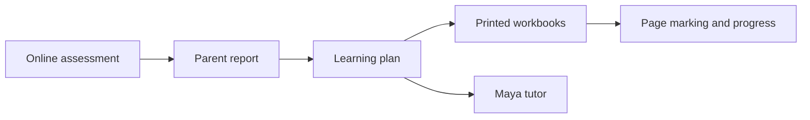

# Unica Learning

A personalized math learning program with mailed workbooks for children ages 5 to 14.

The site supports families from the initial assessment through their learning plan. Visit [unicalearning.com](https://unicalearning.com) to learn more.

## What the product does

- Gives children an online math assessment and provides a report for their parents.
- Creates personalized workbooks and supports the delivery of printed books.
- Lets children work with Maya, an AI tutor, by chat or voice.
- Lets families submit workbook pages for marking and track learning progress.
- Gives the team tools to manage assessments, workbooks and support.



## Use the program

Visit [unicalearning.com](https://unicalearning.com) to get started. A parent creates an account and a child takes the assessment online. Availability of a learning plan depends on the family's curriculum.

## Contributing

This is a private application repository. Report problems and propose changes through the repository's GitHub issues and pull requests. Read [AGENTS.md](AGENTS.md) for project rules, services and the full environment reference before making changes.

### Local setup

Use Node.js 22.23.1, the version used in CI, and npm. You also need access to this private repository. Some product flows require credentials for external services.

```bash
git clone https://github.com/Savar-G/unica-learning.git
cd unica-learning
npm ci
cp .env.example .env.local
npm run dev
```

Open [http://localhost:3000](http://localhost:3000). Fill in the values needed for the flows you test. Supabase settings default to the production project unless overridden. Configure a separate test project before testing account or data flows. Do not commit credentials.

### Configuration

The example file lists common settings. [AGENTS.md](AGENTS.md) has the full list and defaults. Features that use external services need the applicable credentials.

| Variable | Purpose |
| --- | --- |
| `NEXT_PUBLIC_SUPABASE_URL`, `NEXT_PUBLIC_SUPABASE_PUBLISHABLE_KEY` | Override the default Supabase project for browser and account access. |
| `SUPABASE_URL`, `SUPABASE_PUBLISHABLE_KEY`, `SUPABASE_SECRET_KEY` | Configure server access to Supabase. The secret key is server-only. |
| `NEXT_PUBLIC_SITE_URL`, `NEXT_PUBLIC_ALLOW_INDEX` | Set the public URL and control search indexing. Keep indexing off for local work. |
| `STRIPE_SECRET_KEY`, `STRIPE_WEBHOOK_SECRET` | Enable Stripe card setup, plans and webhook verification. |
| `RESEND_API_KEY`, `EMAIL_FROM` | Configure outgoing email. |
| `OPENROUTER_API_KEY` | Enable AI features that use OpenRouter. |
| `NEXT_PUBLIC_POSTHOG_KEY` | Enable optional analytics after visitor consent. |

### Checks

Run the project checks before opening a pull request:

```bash
npm test
npx eslint src
npm run build
```

For a production-mode local run, use `npm run build` followed by `npm run start`. See [AGENTS.md](AGENTS.md) for browser checks and additional checks for specific areas.

## Project documentation

- [Design system and copy rules](DESIGN.md)
- [Product and service conventions](AGENTS.md)
- [Workbook generation](docs/workbook-fast-loop.md)
- [Maya tutor](docs/maya-tutor.md) and [voice](docs/maya-voice.md)
- [Parent dashboard](docs/parent-dashboard.md)
- [Design decisions](.design/decisions.md)

## License and assets

This repository has no stated project license. The self-hosted fonts have separate terms in [src/fonts/FFL-Fontshare.txt](src/fonts/FFL-Fontshare.txt), which restrict redistribution. Keep this repository private. Photo credits are in [.design/assets/stock/CREDITS.md](.design/assets/stock/CREDITS.md).
