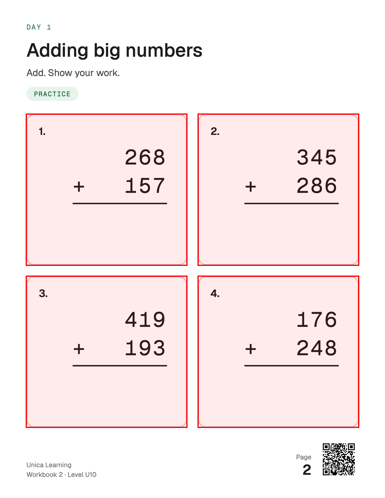
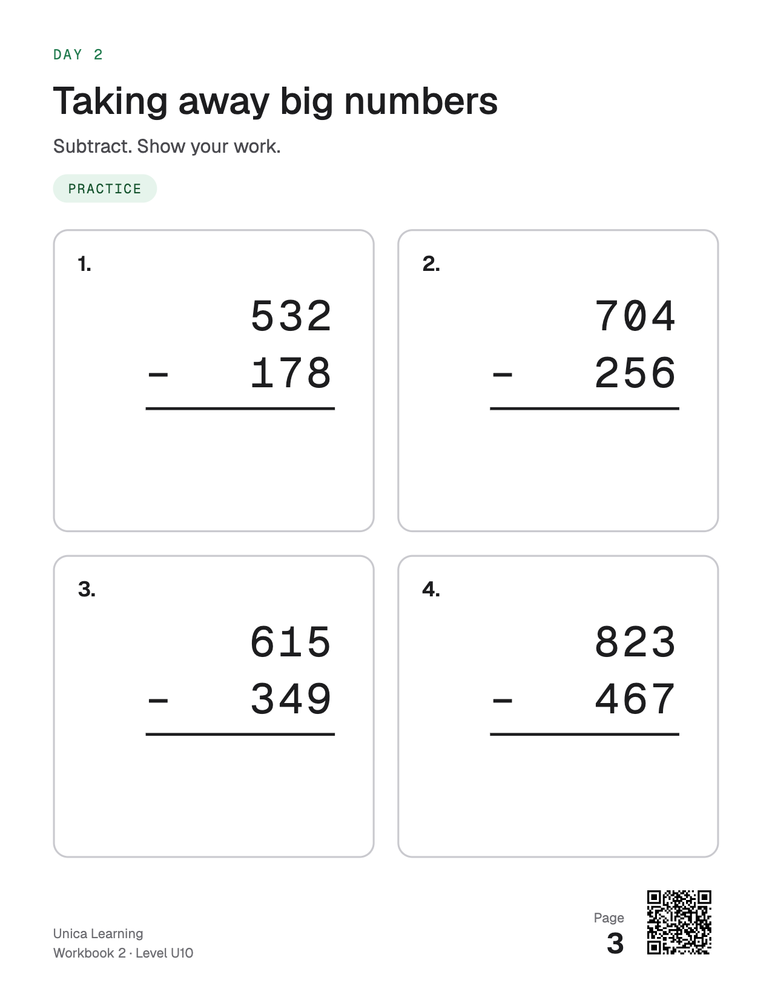

# Workbook rendering

How a workbook's content becomes its print PDF and page images (#309, spec #296).

## What renders

`renderWorkbook` (`src/lib/workbook-render.ts`) takes a workbook draft (pages and question packages, no files or boxes)
and a template, and returns:

- the print PDF (US Letter, one sheet per page),
- one PNG per page at 150 dots per inch (1275 by 1650 pixels),
- each question's box on its page image, measured from the laid-out page,
- each page's QR link, `https://unicalearning.com/tutor/p/<token>` (the desk route, #301).

The template writes each page as HTML and marks what the renderer measures (`mark` in the module): the page number,
each question, inside each question its content (the text and numbers the child reads) and its answer space (which
may lie inside the content), and each slot with a size limit. The renderer makes each page's QR code itself, already marked, and the
template only places it. The render fails, naming the page and question, when:

- the template has no layout for a page's type,
- content overflows a slot, a question box or the page,
- a question is missing from the page, lies outside it or is hidden,
- a question's content does not print in full, or lies outside the question,
- a question has no answer space inside it of at least half an inch each way,
- the page number is not printed on the page as the page's number,
- the QR code is missing, hidden, smaller than 0.6 inches or off the page,
- the QR code read back from the page image is not the page's link (a blank, covered or wrong code),
- the template marks a part twice, or the PDF does not have one page per page.

"Hidden" means not laid out or hidden by CSS: `display`, `visibility`, `content-visibility` or opacity 0. "Printed"
is checked on the text itself, line by line, not only on its outer box. Each line of the page number and of each
question's content must:

- show by CSS: visible, a colour that is not transparent, and no `filter`, `clip-path` or mask up to its marked element,
- be at least 6 points (8 CSS pixels) high,
- lie at least 85% inside every box that clips it, up to the page,
- leave its own ink: the engine takes the page image again with the glyphs of the line's piece of text gone and every
  other glyph that could reach the line kept, and at least 2% of the line's pixels must change by 64 of 255 or more.

The ink check runs after the PDF and page images. It puts each piece of marked text in a plain span (and stops with an
error if any line moved) and hides sets of spans with opacity 0, one check image a set. A set holds pieces that are at
least one line height apart, as far as glyphs reach, so another piece's ink cannot show in a line's place (the third
review on 2026-10-30 found that one image with all glyphs gone let a covered operand pass on the ink of the line over
it). On a page with a text shadow, filter, backdrop filter or reflection, which can carry ink further, each piece gets
its own image.

So text that is hidden, transparent, tiny, shrunk, clipped, blurred, white on white, covered inside a visible box or
covered by another line fails. Very light text (less than 64 of 255 from its background) fails too. Text partly covered by a pattern can still
pass. Nothing is clipped silently.

Storing:

- `saveRenderedWorkbook` (a new workbook) stores the PDF and the images in the private bucket `workbook-pages`, then
  writes the workbook through the workbook store. If an upload fails or the store refuses, it removes every file of the
  render, the failed upload too (Storage may have kept it after its answer was lost). If the write's answer is lost, the
  files stay, because the workbook may be stored: read the workbook to know.
- `replaceRendering` (a stored workbook rendered again) stores the new files, then swaps the workbook to them in one
  database transaction (`save_workbook_rendering`: the workbook row, its page tokens, content, status and learning
  events stay), then removes the old files. If an upload fails or the store refuses the swap, the new files go and the
  old rendering stays. If the swap's answer is lost, it reads the workbook. When the read names the new rendering, the
  swap happened and the old files go. Otherwise every file stays and it throws: the swap may still be pending in the
  database and commit later, so a read of the old rendering does not prove the new files are unused. It never removes
  a file the stored workbook can still name.
- Each stored render gets a random key in its file names (`page-2-<key>.png`), so a retry never meets the files of a
  failed attempt. A file no workbook names (for example the unused rendering after a lost answer) stays in the
  family's folder and is deleted with the family.

## The workbook templates (#310)

`workbookTemplate` (`src/lib/workbook-template.ts`) lays out every page type of `.design/workbooks/DESIGN.md` section
7: the 8-page day (U4 to U18) and the 6-page day (U19 to U30, Math in the world on Days 4 and 9), Friday 5, Show what
you know, the level test, parent-led U1 to U3 pages, the early-level Remember these? pages, Challenge cards, the cover,
How + Plan (a done tick box a day) and the back cover with the level map. Every page has four scan marks and the footer:
the QR code (0.6 inches, the renderer's minimum, not the 42 px of the samples), the page ID
(`UL·<CHILD>·W<nn>·D<nn>·P<n>`) and the book page number, and the wordmark. The fixed test template
(`src/lib/workbook-template-fixed.ts`) stays for the stored samples.

A page's content is data on the draft page (`content`, `src/lib/workbook-page.ts`): its header and its named slots
(`SLOTS`: warm-up, fix-it, worked-example, now-you, on-your-own, mixed-set, challenge, and so on), each naming its
questions by number. It is used to render and is not stored yet (the generator, #311, stores it).

- `pageSlots(page, level)` maps a planned page (`src/lib/workbook-plan.ts`) to its slots and the items each takes.
  Where the plan asks for more than the page holds in DESIGN.md, the slot takes the page's share (the rules are in the
  function's comment); a parent-led page shares 6 cards among its slots, Fix it first, so review items are dropped
  before Fix it items. Every planned part that places fewer items than it asked for is an omission (the part, the
  count asked for and placed, and why); nothing is dropped silently.
- `assembleBook` puts the book in order (cover, How + Plan, the days, back cover, blank pages to a multiple of 4, at
  most 84), numbers the pages from the cover and the questions from 1 on each page, and sets each package's place. It
  returns the draft and the book's omissions with their book page, day and page of the day, for the generator (#311)
  and the admin review (#312). Blank pages carry their book page in their ID (`…·BLANK·P83`). The caller gives each
  page a QR token; a stored book needs random ones (the desk finds a page by its token alone).
- `sampleBook` (`src/lib/workbook-sample-book.ts`) plans a book for any level with the real planner and fills every
  slot with sample questions that pass the package check, so every page type renders without AI. The numbers are for
  the look only.

The day label, the title and the subtitle wrap to a second line at a word break; a third line, or a word wider than
the column, fails the render as the slot's overflow, so nothing is cut. The type ramp is fixed per level band: U10 and up at the reference sizes, U4 to U9 at 18 px and up (facts 30 px),
U1 to U3 at 20 px body with 56 px answer boxes. Nothing is shrunk to fit.

The template's fit check (`fit`, run by the renderer after its own checks) fails a page, naming it, the slot and the
question, when:

- a question (or a slot) runs past the bottom of the 688 by 720 content area, or past its width,
- a slot holds more items than it takes (`slotMax`),
- an answer box is under the band's height (40, 48 or 56 px) or under 40 px wide,
- an answer box or choice strip covers its question's own text,
- a work box is under 44 px, or writing lines are closer than 36 px under the prompt and 34 px apart.

Every element that clips its content is a measured slot, so nothing is clipped silently. `proofPages` prints the
failing pages again with the failure on them (a red banner with each reason, the questions outlined, the content
area's bottom edge dashed), for a reviewer.

`node scripts/render-workbook-templates.mjs <folder> U2 U6 U12 U22 --test U12 --overflow` renders sample books with
the local Chrome and writes one PNG of each page type a level, each book's PDF, and a deliberately overflowing page
with its proof.

Two stored pages of the sample (workbook 2), at full size. On the first, the red boxes are the stored question boxes
drawn over the stored image:

## The print engine

`src/lib/print-engine-chromium.ts` drives headless Chromium with `puppeteer-core`. It is a print engine, not a browser
check, so the Aside rule does not apply. Which Chromium:

- `CHROMIUM_PATH` when set,
- on Linux (a Vercel function), the serverless build `@sparticuz/chromium`,
- on a Mac, the installed Google Chrome or Chromium.

Tests use the fake engine (`src/lib/print-engine-fake.ts`). `src/lib/print-engine-chromium.test.ts` renders the sample
with real Chromium wherever one is found: it decodes each page's QR code from the image, counts the PDF pages, and
checks that a hidden page number, a hidden question, a blank QR code, a transparent page number, a missing answer space,
and question content that is hidden, white, tiny, shrunk, clipped, covered or blurred inside a visible box fail, while
content set at a tight line height prints. Set `RENDER_OUT=<folder>` to keep the
files and look at them.

The engine reads each page's QR code with jsQR from the page image, cropped to the QR element and a quarter inch around
it, so the check costs little.

Licences of the engine's parts and of the embedded fonts: `THIRD_PARTY_NOTICES.md`.

## Where it runs: a Vercel function

Rendering runs in a Vercel function (Node, `sfo1`), the same as the report job. The serverless Chromium needs no
other service. Measured on a preview deploy on 2026-10-29 with `/api/workbook-render-check`:

| Book | Render time | PDF | Page images |
|---|---|---|---|
| Sample, 3 pages, first call (cold) | 3.6 s (4.5 s request) | 93 KB | 197 KB |
| Sample, 3 pages, warm | 1.1 s | 93 KB | 197 KB |
| 30 pages | 7.2 to 7.5 s | 559 KB | 2.3 MB |
| 60 pages | 14.9 s | 1.07 MB | 4.65 MB |

That is about 0.25 s a page once Chromium is running. Reading each page's QR code back from its image (added after
review, measured on 2026-10-30) adds about 0.05 s a page: the sample in 1.3 s warm (4.1 s cold), 30 pages in 8.9 s. The function's traced files are 75 MB (the compressed Chromium
is 67 MB of it), under Vercel's 250 MB limit. The check route allows 60 s (`maxDuration`). Files go straight to
Storage, so Vercel's 4.5 MB response limit does not apply. A two-week workbook (about 10 to 30 pages) renders in under
10 seconds.

On a Mac (Chrome 155, Apple silicon), the sample renders in 0.6 to 1.2 s and 30 pages in 3.0 s. The check that each line of text
leaves its own ink adds about 0.06 s a check image there, and a sample practice page takes 2 (the cover 1). Measured
on an 84-page book of sample pages on 2026-10-30: 6.0 s to the PDF, then the ink check takes 9.9 s with the sets (167
images), against 5.7 s for one image a page with all glyphs gone (84 images, which let a covered line pass) and 97.5 s
for one image a piece of text (1664 images). It has not been measured on Vercel yet.

### When to move it to a worker

Move rendering to a worker (a GitHub Actions job, like the retention worker, or a container) when any of these holds:

- a real workbook's render takes more than 30 s, half the 60 s limit (about 120 pages at today's speed),
- a render fails for memory or the function's traced files pass 200 MB,
- the generator (#311) needs render and AI calls in the same request and they together near the limit.

Check with `/api/workbook-render-check?pages=<3 to 60>` and `Authorization: Bearer <CRON_SECRET>` (on a preview, use
`npx vercel@latest curl`). It renders the sample with placeholder ids, stores nothing and answers with the time and
sizes. It is off in production unless the variable `RENDER_CHECK` is `on`, and each function instance runs one check
at a time (a second call while one runs gets 429).

## The sample workbook

`node scripts/load-workbook-sample.mjs --child <id>` renders and stores a new sample for a test family.
`node scripts/load-workbook-sample.mjs --rerender <workbook id>` renders a stored workbook of a test family again with
`replaceRendering`, keeping its id, page tokens, content, status and learning events. Both stored samples were last
rendered on 2026-10-29; the renderer's output for them has not changed since.
